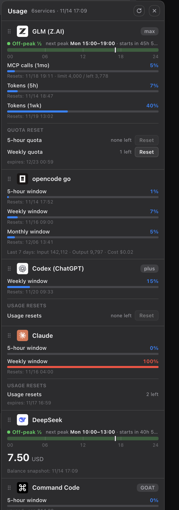
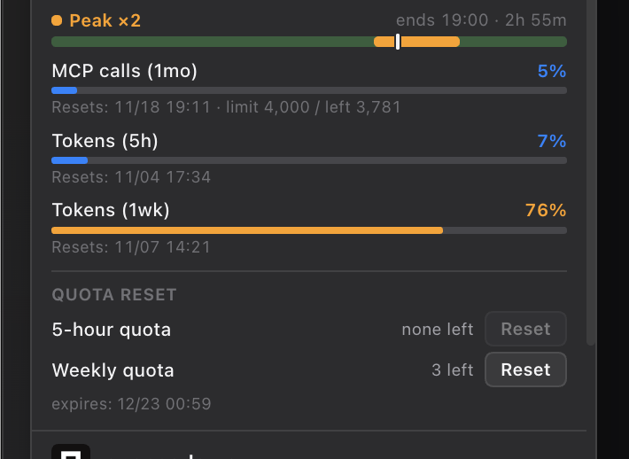

# dsh-usage-panel

[](https://awesome-dsh-plugin.com)

**All your AI coding subscriptions in one popup** — for [DeepSeek Harness (DSH)](https://github.com/deepseek-ai/DeepSeek-Harness).

GLM (Z.AI) / opencode go / Codex (ChatGPT) / Claude / DeepSeek / Command Code usage, shown as clean cards in a sidebar popup. Quota-reset credits (GLM / Codex) can be spent **from the panel**. No dependencies — Node.js 18+ only.



## Features

- **One popup, every subscription** — only shows services you actually use. 5-hour / weekly / monthly windows with usage bars, reset times and plan badges. 70%+ amber, 90%+ red.
- **Spend quota resets from the panel** — GLM coding-plan resets (5-hour / weekly) and Codex reset credits with two-step confirm. Claude reset credits are shown read-only.
- **Peak clock** — for time-of-day-priced models (GLM, DeepSeek) a 24h band shows peak vs off-peak windows, current time, and the exact start/end times in your local timezone.
  
- **Fast by design** — stale-while-revalidate: the last snapshot renders instantly while fresh data loads underneath. Server warms its cache at boot; polling stops when the panel or window is hidden.
- **Drag to reorder** — grab the ⋮⋮ handle on any card. Order persists in `localStorage`; the header button resets it.
- **CLI included** — `node usage.mjs` prints the same data in your terminal (`--json` for scripting).

## Install (DSH desktop)

1. Clone or download this repository.
2. DSH → **Plugins → Add plugin → Install a third-party plugin**.
3. Select the `bundle` folder of this repository.

Web profile: `dsh plugin --profile web add <path-to>/dsh-usage-panel/bundle`.

The panel mounts a small usage-server on `127.0.0.1:50071` when DSH loads the plugin — no manual steps, no background daemon. Open it from the **Usage** button at the bottom of the sidebar.

## Where credentials are read from

The server reads tokens **locally only** — nothing is sent anywhere except the official endpoints of each service. Tokens never reach the browser side.

| Service | Source |
|---|---|
| GLM resets | `~/.zcode/v2/credentials.json` (ZCode's encrypted store, decrypted in-process) |
| Codex / Claude | `~/.dsh/plugins/subscriptions/auth.json` (DSH subscription logins) |
| DeepSeek | balance snapshot from `@linxin666/dsh-usage` if installed |
| opencode go | `~/.local/share/opencode/account.json` + official usage API |
| GLM usage | `ZAI_API_KEY` env or `~/.config/opencode/opencode.json` |
| Command Code | `COMMANDCODE_API_KEY` env or `~/.dsh/.env` |

Services without credentials are simply not shown.

## Reset safety

Resets are irreversible, so the local server requires:

- a custom header (`x-sup-reset: 1`) + JSON content-type — plain cross-site POSTs cannot reach it
- an allow-listed `Origin` (`dsh-app://app`, `127.0.0.1`, `localhost`, `[::1]`)
- two-step confirmation in the UI

## Unofficial endpoints

Codex / Claude usage numbers come from unofficial endpoints and may break when those services change. Everything else uses official APIs.

## CLI

```bash
node usage.mjs            # GLM + opencode go
node usage.mjs glm        # GLM only
node usage.mjs --json     # JSON output
node server.mjs           # standalone usage server (usually unnecessary)
```

## Adding a provider

See [docs/add-provider.md](docs/add-provider.md) for a 3-step guide: write a fetcher, register it in `fetchAllSubscriptions`, and drop a 64px icon. The server contract is one small JSON object — see the table there.

## Development

```bash
node verify.mjs           # bundle syntax / module contract / boundary checks
```

## Terms of Service risk

This panel calls **non-official endpoints** for two services. Know before you use:

- **Claude**: usage numbers come from Anthropic's OAuth usage endpoint using the token Claude Code stores in your Keychain. Anthropic's [Authentication and credential use policy](https://code.claude.com/docs/en/legal-and-compliance) (updated Feb 2026) restricts third-party developers from offering Claude.ai login in their own applications and from collecting or intermediating Claude.ai credentials or session tokens. A local panel that reads the token Claude Code itself stored is a gray area — treat it accordingly and consider whether you are comfortable with that before enabling the Claude card.
- **Codex (ChatGPT)**: usage numbers and reset-credit consumption use undocumented `chatgpt.com/backend-api/wham/*` endpoints. OpenAI's [Terms of Use](https://openai.com/policies/row-terms-of-use/) prohibit programmatically extracting data and circumventing rate limits; spending a reset credit is an action ChatGPT itself offers in its UI, but automated consumption is your judgement call.
- **GLM (Z.AI)**: reset consumption calls the same `zcode.z.ai` API the official ZCode app calls with the same account tokens. Z.AI's [Usage Policy](https://docs.z.ai/devpack/usage-policy) limits the plan to officially supported tools — a third-party panel may fall outside that wording.

Everything else (opencode go, Command Code) uses documented official APIs with your own API keys. If any of this is not acceptable to you, remove the corresponding card by not connecting that service — the panel simply hides services without credentials.

## License

MIT
